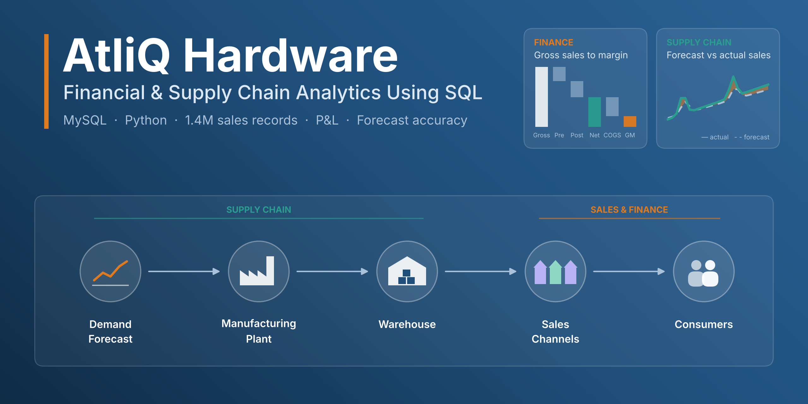

# AtliQ Hardware: Financial & Supply Chain Analytics Using SQL


---

## 1. Project Overview

AtliQ Hardware is a fictional manufacturer of computer hardware that sells through retailers, its own stores and distributors in 27 markets. This project uses **SQL** to build a complete profit and loss view of **1.4 million sales records**, analyse where AtliQ Hardware's revenue and profit come from, and measure how accurately it forecasts demand. **Python** is used to visualise the key findings.

**Headline results:** net sales grew from USD 29M to USD 824M in three years while gross margin held at 36–41%, driven by a shift towards high-value PCs. But AtliQ Hardware's largest market earns a below-average margin, and its forecasts increasingly fall short of demand, putting a growing share of sales at risk.

---

## 2. Business Problem

AtliQ Hardware operates across many markets, customers, channels and products, generating large volumes of sales and financial data, but lacks a consolidated view of its performance. It needs to understand where revenue comes from, how discounts and deductions reduce net sales, how costs affect profitability, and which markets, customers and products contribute most.

At the same time, its supply chain team plans production from monthly demand forecasts. Inaccurate forecasts lead either to excess stock, which costs money to hold, or to shortages, which put sales at risk. The business needs to know how accurate its forecasts are, where errors are largest, and what they cost.

---

## 3. Business Objectives

1. Build a complete P&L for every sale, from gross sales to gross margin
2. Identify the main drivers of revenue and profitability by market, customer, channel and product
3. Measure how much revenue is lost to discounts and rebates
4. Evaluate demand forecast accuracy and the direction of forecast errors
5. Estimate the financial cost of forecasting errors

---

## 4. Project Highlights

- **Full P&L built in SQL** for 1,425,706 sales rows, validated with zero mismatches on every formula
- **40 analytical queries** answering specific business questions, from subqueries and CTEs to window functions and stored procedures
- **A cost-of-forecast-errors model**, estimating stock month by month to value both excess stock and sales at risk
- **8 charts** in Python, each stating its finding in the title
- **Documented assumptions and limitations**, so every number can be traced and defended

---

## 5. Project Architecture

How AtliQ Hardware gets its products from forecast to consumers, through three sales channels:

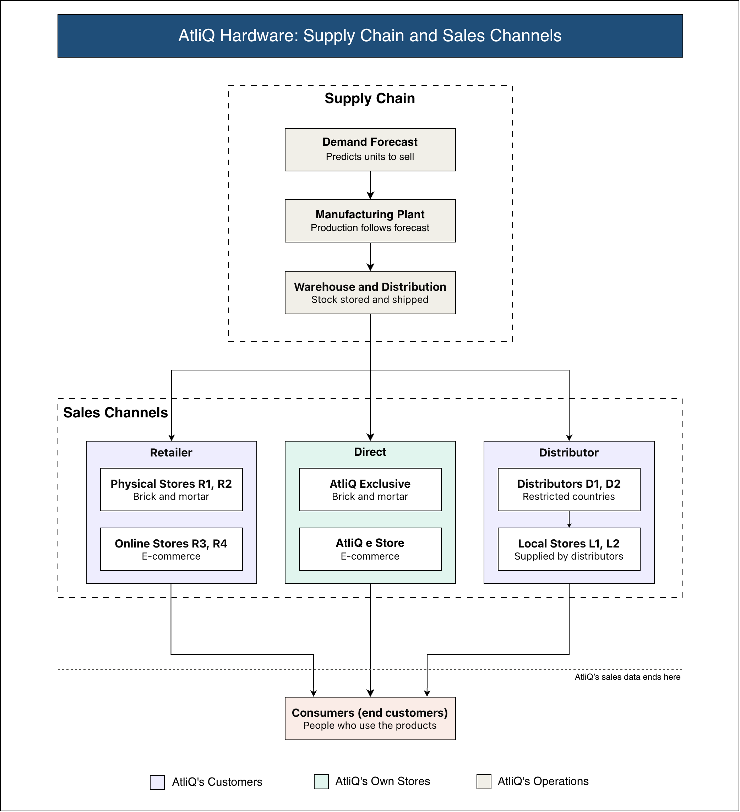

**The P&L used throughout the analysis:**

| Step | Formula |
|---|---|
| Gross Sales | Sold Quantity × Gross Price |
| Pre-Invoice Deductions | Gross Sales × Pre-Invoice Discount % |
| Net Invoice Sales | Gross Sales − Pre-Invoice Deductions |
| Post-Invoice Deductions | Net Invoice Sales × (Discount % + Other Deductions %) |
| Net Sales | Net Invoice Sales − Post-Invoice Deductions |
| COGS | Manufacturing Cost + Freight Cost + Other Cost |
| Gross Margin | Net Sales − COGS |
| Gross Margin % | Gross Margin ÷ Net Sales × 100 |

---

## 6. Dataset Information & Credit

The dataset was provided as part of the course **SQL** by **Codebasics**. Full credit goes to **Mr. Dhaval Patel** and the Codebasics team for the dataset and learning resources.

> **Note:** The dataset is not publicly available and is not included in this repository, as the course provider does not permit it to be shared. This project was created for educational and portfolio purposes.

The data covers AtliQ Hardware's sales, forecasts, prices, deductions and costs in **9 tables**: 2 dimension tables and 7 fact tables. Full details are in [`docs/data_dictionary.md`](docs/data_dictionary.md).

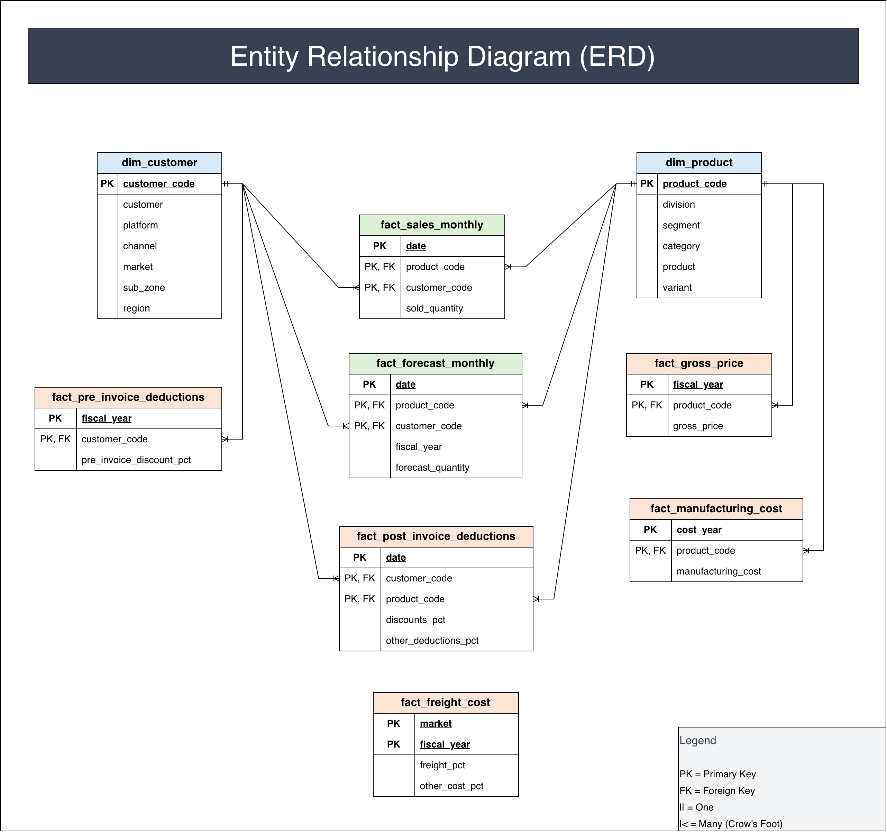

---

## 7. Project Workflow

| Step | File | What it does |
|---|---|---|
| 1 | [`01_data_exploration.sql`](sql/01_data_exploration.sql) | First look at each table: selecting, filtering, sorting |
| 2 | [`02_data_profiling.sql`](sql/02_data_profiling.sql) | Row counts, value ranges, missing values, data quality checks |
| 3 | [`03_table_relationships.sql`](sql/03_table_relationships.sql) | Joins, checks for lost or duplicated rows, unmatched records |
| 4 | [`04_pnl_foundation.sql`](sql/04_pnl_foundation.sql) | Fiscal year function, P&L built in four layers of views, validation |
| 5 | [`05_financial_analytics.sql`](sql/05_financial_analytics.sql) | Growth, product mix, markets, customers, channels, discounts |
| 6 | [`06_supply_chain_analytics.sql`](sql/06_supply_chain_analytics.sql) | Forecast accuracy, inventory estimate, cost of forecast errors |
| 7 | [`business_insights.ipynb`](data_visualization/business_insights.ipynb) | Python charts of the key findings |

---

## 8. Results

### 8.1. Rapid growth with stable profitability
Net sales grew from **USD 29M in FY2018 to USD 824M in FY2021**, more than doubling every year, while gross margin stayed between about **36% and 41%**.

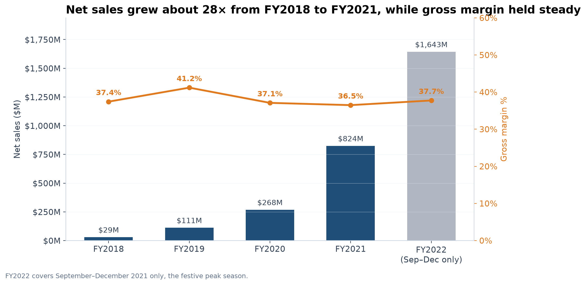

### 8.2. A strong shift towards high-value PCs
Notebooks and desktops grew from **25.5% to 58.7%** of net sales. Average prices rose only about 6% a year, so the rise in revenue per unit came mainly from this product mix shift.

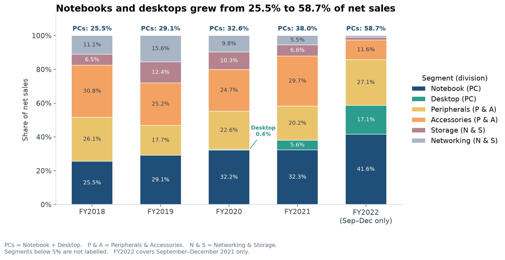

### 8.3. Strongly seasonal demand
Sales peak from October to December, with November and December nearly **double** a normal month.

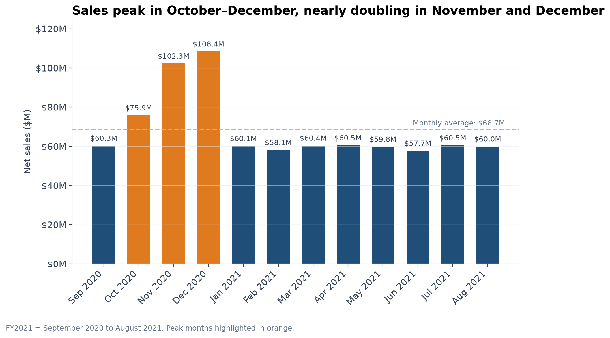

### 8.4. The largest market earns a below-average margin
**India**, AtliQ Hardware's largest market (USD 210.7M, about a quarter of net sales), earns about **32%** against the company's **36.5%**. Seven of 27 markets bring in **70%** of net sales.

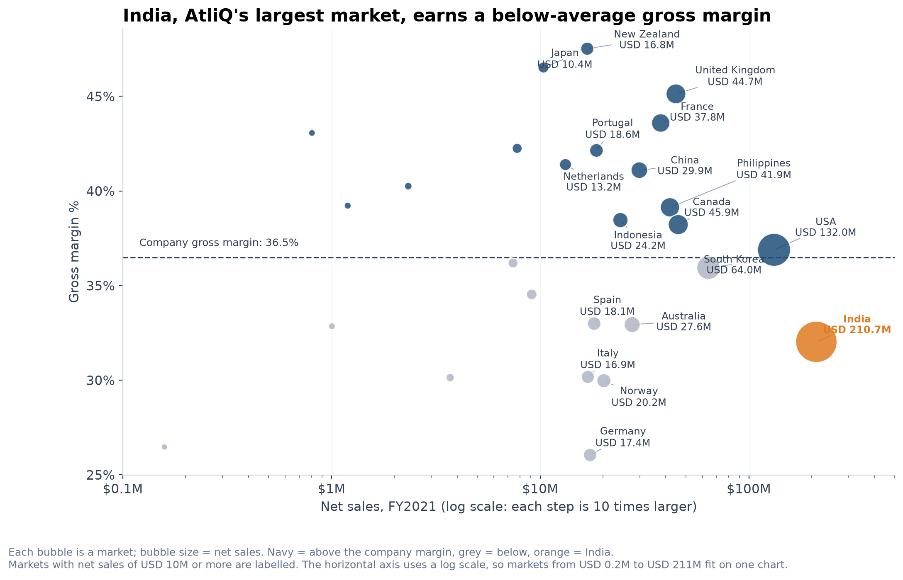

### 8.5. Discounts and rebates drive customer profitability
AtliQ Hardware's top customers receive **44–55%** of the list price back in deductions, and the more they receive, the less profitable they are. **Flipkart** receives the most (55%) and has the lowest margin (30%); AtliQ Hardware's own stores the least, with the highest margin.

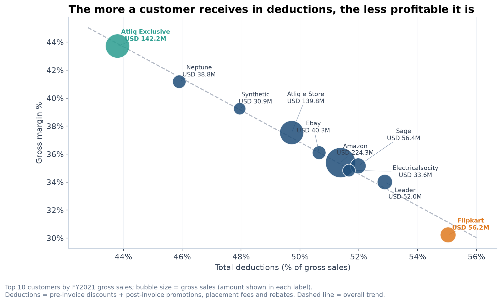

### 8.6. Low forecast accuracy, shifting towards under-forecasting
Forecast accuracy stayed around **37–41%**, and errors moved from forecasting too much (**+16.4%** in FY2018) to forecasting too little (**−9.5%** in Sep–Dec 2021).

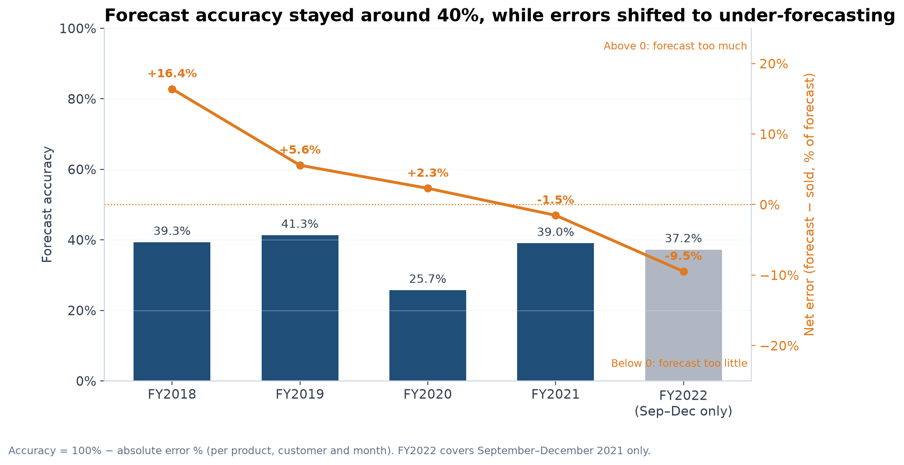

### 8.7. Under-forecasting hits major markets
Every under-forecast market had accuracy of **37.8% or less**, including **South Korea (18.3%)** and the **USA (35.4%)**.

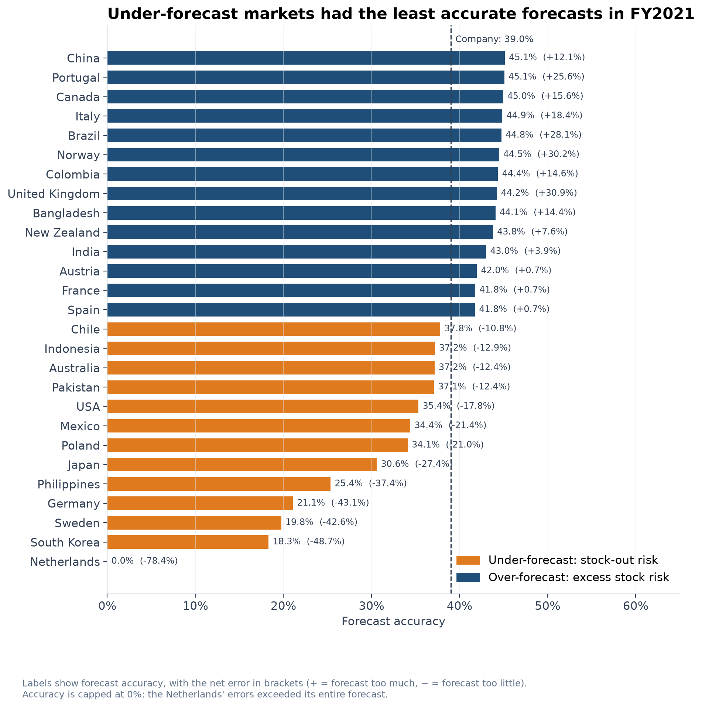

### 8.8. Under-forecasting is the bigger cost
The gross margin at risk from forecasting too little (**2.7% of net sales, USD 21.8M in FY2021**) exceeds the estimated cost of holding excess stock (**1.5%, USD 12.6M**), and the gap is growing.

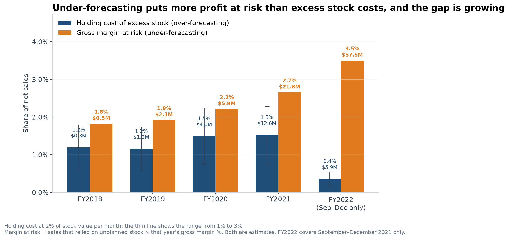

---

## 9. Recommendations

1. **Review discount and rebate agreements** with low-margin customers and markets. Germany's low margin, for example, comes almost entirely from post-invoice rebates (45.5% of invoice value, against 27.1% in the Netherlands).
2. **Improve profitability in India**, where higher deductions and costs pull down the company's overall margin.
3. **Grow the Direct channel**, AtliQ Hardware's most profitable route to customers (40.8% gross margin, against 35.4% for retailers).
4. **Improve forecasts for fast-growing customers and markets**, where under-forecasting puts the most sales at risk.
5. **Plan stock ahead of the October–December peak**, and **cut forecasts faster for declining categories** such as external SSDs, where stock builds up.

---

## 10. Validation

Every result rests on checks built into the SQL:

- **1,425,706 rows** and **125,291,556 units** carried from raw sales to the final P&L, with nothing lost or duplicated
- **0 mismatches** on every P&L formula, checked on every row
- **0 mismatches** between the fiscal year logic and the company's own fiscal years, across 1,885,941 forecast rows
- **1,488,187** forecast-vs-actual combinations, with units forecast and sold matching their sources exactly
- Join checks for every table, confirming each sale matches exactly one price, discount and cost

---

## 11. Assumptions & Limitations

- Freight and other costs are calculated as a percentage of net sales.
- The inventory estimate assumes production equals the forecast; holding cost is charged at 2% of stock value per month, tested at 1% and 3%.
- Revenue at risk represents sales exposed to stock-out risk, not confirmed lost sales.
- The dataset records sales to AtliQ Hardware's customers, not customer orders or consumer sales, so lost sales cannot be measured.
- Sales data ends in December 2021, so FY2022 covers September–December only.

Full details: [`docs/assumptions.md`](docs/assumptions.md)

---

## 12. Skills Demonstrated

- **SQL:** joins, aggregations, CASE, subqueries, CTEs, window functions (RANK, DENSE_RANK, ROW_NUMBER, LAG, LEAD, running totals), UNION ALL, views, user-defined functions, stored procedures, indexes
- **Data validation:** grain analysis, join checks, reconciliation of totals, formula checks
- **Financial analysis:** P&L construction, margin analysis, discount leakage, growth analysis
- **Supply chain analysis:** forecast accuracy, forecast bias (over- vs under-forecasting), inventory estimation, cost of forecast errors
- **Data visualisation:** clear, finding-led charts in Python
- **Documentation:** data dictionary, assumptions, limitations

---

## 13. Tools & Technologies

| Tool | Used for |
|---|---|
| MySQL | Data storage, analysis and P&L modelling |
| Python | Data visualisation |
| pandas | Loading query results into tables |
| NumPy | Calculations for chart layout and trend lines |
| SQLAlchemy and PyMySQL | Connecting Python to MySQL |
| Matplotlib | Charts |
| adjustText | Placing chart labels without overlaps |
| python-dotenv | Keeping database credentials out of the code |
| Jupyter Notebook | Charts and insights in one document |
| draw.io | Architecture diagram and ERD |
| PyCharm | Development environment |

---

## 14. Project Structure

```
AtliQ_Hardware_Financial_and_Supply_Chain_Analytics/
│
├── README.md
├── requirements.txt
├── .gitignore
│
├── assets/
│   └── project_banner.png
│
├── architecture/
│   ├── atliq_hardware_business_flow.png
│   └── atliq_hardware_business_flow.drawio
│
├── ERD_Entity_Relationship_Diagram/
│   ├── ERD_Entity_Relationship_Diagram.png
│   └── ERD_Entity_Relationship_Diagram.drawio
│
├── docs/
│   ├── assumptions.md
│   └── data_dictionary.md
│
├── sql/
│   ├── 01_data_exploration.sql
│   ├── 02_data_profiling.sql
│   ├── 03_table_relationships.sql
│   ├── 04_pnl_foundation.sql
│   ├── 05_financial_analytics.sql
│   └── 06_supply_chain_analytics.sql
│
└── data_visualization/
    ├── business_insights.ipynb
    └── charts/
        ├── 01_net_sales_and_gross_margin.png
        ├── 02_product_mix_by_year.png
        ├── 03_monthly_net_sales_fy2021.png
        ├── 04_markets_sales_vs_margin.png
        ├── 05_forecast_accuracy_by_year.png
        ├── 06_cost_of_forecast_errors.png
        ├── 07_discount_leakage_top_customers.png
        └── 08_forecast_accuracy_by_market.png
```

---

## 15. How to Run the Project

1. **Import the data** into a MySQL database. The dataset is not included in this repository (see [Dataset Information & Credit](#6-dataset-information--credit)).
2. **Set the database name:** replace `your_database` in the `USE` line at the top of each SQL file.
3. **Run the SQL files in order**, from `01` to `06`. File 4 builds the P&L tables used by files 5 and 6.
4. **Create a `.env` file** in the project folder with your MySQL details:
   ```
   DB_USER=your_username
   DB_PASSWORD=your_password
   DB_HOST=localhost
   DB_PORT=3306
   DB_NAME=your_database
   ```
5. **Install the Python libraries:**
   ```
   pip install -r requirements.txt
   ```
6. **Open the notebook** `data_visualization/business_insights.ipynb` and run all cells.

---

## 16. Future Improvements

- **Demand forecasting model:** build a forecasting model and test whether it beats the current 37–41% accuracy
- **Product-level margin at risk:** value shortfalls using each product's own margin instead of the yearly average

---

## 17. Conclusion

AtliQ Hardware has grown very quickly while keeping its profitability stable, helped by a shift towards high-value PCs. However, two issues stand out: discount and rebate agreements are reducing margins in key markets and with key customers, and demand forecasts are not keeping pace with growth, putting a rising share of sales at risk. Reviewing these agreements and improving forecasts for fast-growing markets and customers are the clearest opportunities to protect AtliQ Hardware's profit as it continues to grow.
